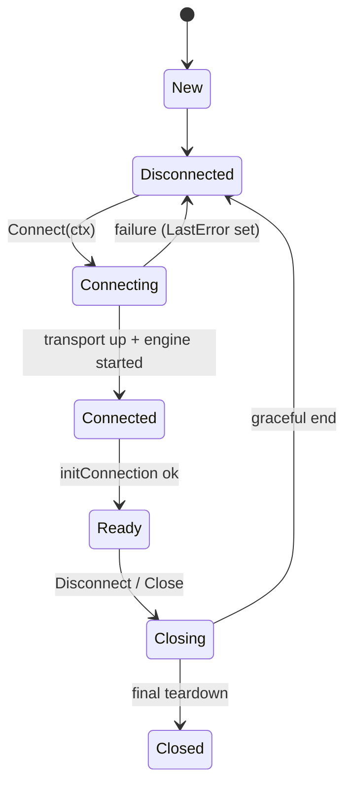

# Client Architecture (Phase 6)

The `client` package is the production user-facing API on top of the frozen
Phase 2–5 foundations.

## Lifecycle



- `Connect` is idempotent, serialized (`connectMu`), and context-bound.
  Concurrent Connects: one proceeds, others get `ErrConnectInProgress` or
  return nil after completion.
- `Close` is terminal and safe to call concurrently/never-connected.
  Everything after Close returns `ErrClosed`.
- A failed Connect unwinds completely (engine, updates, transport) and
  lands in `Disconnected` with `LastError` populated.
- Connect performs the DH exchange **only when the session has no key**;
  reconnection reuses the persisted key (E2E-asserted via the fake
  server's exchange counter).

## RPC pipeline

```
Invoke(ctx, req)
  → serialize (generated Encode)
  → engine.Invoke: msg_id/seq assign → register → seal envelope → transport
  → response dispatcher (decrypt → TL decode → correlate)
  → client retry policy (server-internal errors, tolerated flood waits)
  → entity extraction → result
```

Retry classification (reference `users.py:_call`): 500-class and
RPC_CALL_FAIL family are retried with 2 s backoff; FLOOD_WAIT ≤ threshold
sleeps then retries; FLOOD_WAIT > threshold surfaces; migration errors
surface; **connection loss never retries automatically** (the ambiguity
window would risk duplicate side effects). Context cancellation wins over
every retry sleep.

## Concurrency model

Fixed goroutines per ready client: transport (3/connection) + engine
dispatcher + update feeder + N update workers (default 4). Zero
goroutine-per-request. Synchronization:

| Primitive | Guards |
|---|---|
| `stateMachine.mu` | lifecycle state (short critical sections; notify unlocked) |
| `client.mu` (RWMutex) | engine/transport/updates pointers |
| `client.connectMu` | Connect/Disconnect/Close bodies |
| `entityCache.mu` | entity map |
| `updateManager.regMu` | handler registry |
| rpc engine registry | pending requests (Phase 4) |

## Updates

`engine.Updates() → feeder → bounded queue (1024) → workers → handlers`.

- Delivery: each update to every registered handler exactly once;
  workers process in arrival order per worker (set `UpdateWorkers: 1`
  for strict ordering).
- Overflow (explicit policy): the feeder waits ≤250 ms when full, then
  **drops the newest** update, counts it (`DroppedUpdates`), and fires
  `Hooks.OnSlowConsumer`. Rationale: drop-newest preserves the queue as a
  contiguous prefix of the update stream; the network reader is never
  blocked by slow handlers.
- Panic isolation: a panicking handler is recovered per delivery; healthy
  handlers are unaffected (tested).
- Unsubscribe is idempotent and concurrent-safe (tested).
- Reference `_store_own_updates` semantics: update-family rpc_results
  (`updates`, `updatesCombined`, `updateShort*`) reach both the Invoke
  caller and the update stream.

## Entity resolution

Domain entities (`User`, `Chat`, `Channel`) are converted from generated
TL at the boundary; raw TL access remains via `Invoke` and `SeedEntities`.
The entity cache (bounded 4096) records access hashes learned from
response families (resolved peers, user vectors, message batches, updates).
`ResolvePeer` converts a `Peer` to a wire `InputPeer`, consulting the
cache; **access hashes are never fabricated** — a cache miss returns
`ErrAccessHashUnavailable` and the caller must resolve first
(`ResolveUsername` or `GetMe`).

## Failure model

| Event | Behavior |
|---|---|
| ctx cancelled / deadline | Invoke returns immediately; pending finalized; retries abandoned |
| connection lost mid-request | pending fails `rpc.ErrConnectionLost` (no auto-retry) |
| transport closed while Ready | state → Disconnected; Connect re-establishes |
| RPC 4xx/403 | surfaced as `*rpc.RPCError` |
| 5xx / RPC_CALL_FAIL | retried ≤ Retries with 2 s backoff |
| FLOOD_WAIT_X | slept+retried if X ≤ threshold, else surfaced |
| malformed server data | contained per message; counters + hooks; never panics |
| shutdown | pending fails `rpc.ErrEngineClosed`; no goroutine survives |

## Security boundaries

No hook or error receives auth keys, nonces, or session secrets. The fake
server in tests shares a key with the client by construction (pre-seeded
session) — production keys never leave the process. All the Phase 5
guarantees (0600 session files, redaction, corruption detection) apply.

## Performance (measured, windows/amd64)

| Benchmark | Result |
|---|---|
| Invoke (ping, full round trip) | ~24.7 µs/op, 10.8 KiB, 124 allocs |
| Invoke (parallel) | ~8.6 µs/op |
| Entity conversion | 85 ns/op, 1 alloc |
