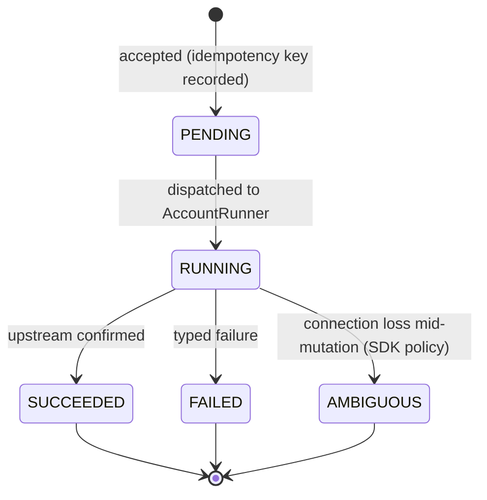

# Domain Model (Phase 24 design)

Language-agnostic entities. Go structs live in the service's domain
package during implementation; **none of these couple to protobuf or
SDK types**.

## Entities & value objects

| Entity | Identity | Key fields (design) | Invariants |
|---|---|---|---|
| `Tenant` | UUID | name, status, quotas, created_at | quotas immutable per version; deletion soft then purge |
| `AppCredential` | UUID | tenant_id, key_hash (SHA-256), prefix (`sk_…` first 8 chars for identification), permissions, status, expires_at | exactly one tenant; raw key shown once at creation; revocation is immediate |
| `AccountBinding` | UUID | tenant_id, phone_hash (HMAC for lookup), display alias (operator-chosen), status: `PENDING_AUTH → ACTIVE → SUSPENDED → REMOVED` | one account ↔ one tenant; phone stored only as keyed hash + masked display |
| `AccountSession` | account UUID (1:1) | wrapped DEK, encrypted session blob, format version, updated_at, revocation marker | ≤1 active per account; blob unreadable without external KEK |
| `ConnectionState` | per account | desired: `STOPPED / RUNNING`; observed: `DISCONNECTED / CONNECTING / CONNECTED / READY`; last_error_class | desired vs observed separation (reconciliation loop) |
| `Peer` | (account, kind, id) | kind: USER/CHAT/CHANNEL, id, access_hash (server-provided only), cached display alias | never fabricated; matches SDK invariant |
| `Message` | (account, peer, msg_id) | direction, text, entities, media refs, reply header, date, edited flag | identity = (peer, id) — never id alone (SDK invariant) |
| `Dialog` | (account, peer) | top message ref, unread counts, read maxima | derived view; not authority |
| `Update` | monotonically ordered per account | type, payload, pts metadata | ordering from MessageBox; service adds per-stream sequence numbers |
| `MediaRef` | upload id / message media location | size, mime, part state, file reference | file_reference handled verbatim; expiry typed |
| `OperationStatus` | operation UUID | idempotency key, state: `PENDING/RUNNING/SUCCEEDED/FAILED/AMBIGUOUS`, error class | dedupe window per (tenant, key); ambiguity preserved, never resolved by guessing |

## State machines

### AccountBinding

```mermaid
stateDiagram-v2
    [*] --> PENDING_AUTH: bind(phone)
    PENDING_AUTH --> PENDING_AUTH: SendCode / SubmitCode / SubmitPassword
    PENDING_AUTH --> ACTIVE: authorization confirmed (GetMe)
    ACTIVE --> SUSPENDED: operator action / quota breach
    SUSPENDED --> ACTIVE: operator action
    ACTIVE --> REMOVED: remove (session crypto-shredded)
    SUSPENDED --> REMOVED: remove
    REMOVED --> [*]
    ACTIVE --> PENDING_AUTH: revoked upstream (401-class)
    note right of PENDING_AUTH: OTP exists only inside one RPC; never persisted
```



### OperationStatus



`AMBIGUOUS` is a **first-class terminal state**: the service reports it
honestly (gRPC `UNAVAILABLE` + error detail `operation_ambiguous`) and
never replays the mutation to "resolve" it.

## Repository interfaces (ports)

```go
type TenantRepository interface{ /* CRUD, quota lookup */ }
type CredentialRepository interface{ /* hash lookup, revoke */ }
type AccountRepository interface{ /* bind/list/status per tenant */ }
type SessionRepository interface {
    Load(ctx, accountID) (wrappedBlob []byte, dekWrapped []byte, version int, err error)
    Store(ctx, accountID, blob, wrappedDEK) error
    Delete(ctx, accountID) error          // crypto-shred: delete wrapped DEK
}
type OperationRepository interface{ /* idempotency dedupe + audit trail */ }
type LeaseRepository interface{ /* future: account sharding (ADR-002/007) */ }
```

All persistence is behind these ports; PostgreSQL is the v1 adapter
(ADR-009). The SDK adapter (port `UpstreamGateway`) wraps every SDK
interaction so the application layer never imports the SDK.

## Anti-corruption rules

- Protobuf types exist only in the transport adapter; conversion is
  explicit and total (no passthrough of unknown fields).
- SDK types (e.g. `*client.Message`) are converted at the adapter
  boundary into domain `Message`; SDK errors map to domain error
  classes which map to gRPC status + error details at the edge.
- The domain never imports `github.com/Skryldev/suromesh/...` — enforced
  by package layout and reviewed per PR.
