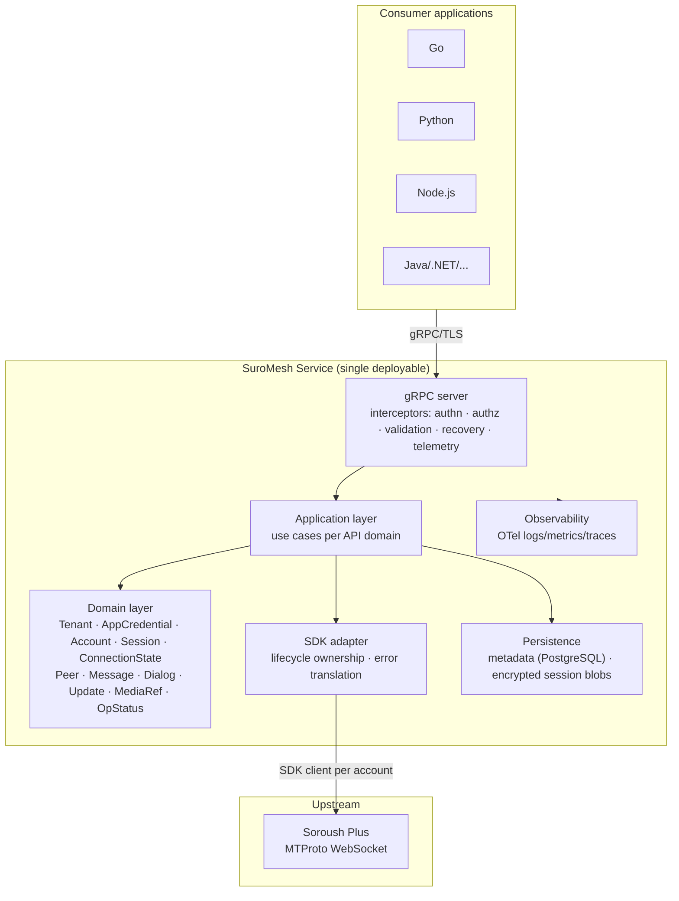

# SuroMesh Service — System Architecture (Phase 24 design)

Product: **SuroMesh Service** — a production-grade gRPC microservice
exposing the SuroMesh Go SDK (MTProto 2.0, Layer 182) to applications
in any gRPC language, with multi-tenant account isolation, encrypted
session persistence, and OpenTelemetry observability.

This is a design specification. Implementation follows in the roadmap
phases after architecture review.

## 1. System context



The SDK remains an **independent reusable library** (`github.com/Skryldev/suromesh`).
The service is a separate Go module that depends on it. No gRPC
dependency ever enters the SDK module; no protocol logic is duplicated.

## 2. Architectural style

Hexagonal (ports & adapters), with an explicit domain core:

| Layer | Contents | Depends on |
|---|---|---|
| Transport (inbound adapter) | gRPC server, generated stubs, interceptors, request validation, error translation, health | Application interfaces |
| Application | Use cases per API domain (auth, account, connection, messaging, dialogs, updates, media, session mgmt) | Domain + ports |
| Domain | Entities/value objects + repository & gateway **interfaces** | nothing |
| Infrastructure (outbound adapters) | SDK adapter, PostgreSQL repositories, secret/crypto service, config, OTel | Domain interfaces |

Key boundary rule: **the domain layer never imports the SDK or protobuf
packages**; the SDK adapter translates domain commands into SDK calls
and SDK results/errors into domain results/errors. Generated protobuf
types exist only at the transport edge (see `api-design/protobuf.md`).

## 3. Core design decisions (ADRs)

| # | Decision |
|---|---|
| ADR-001 | Nested Go module `service/` in the existing repository (not a separate repo) |
| ADR-002 | Single-process deployment first; horizontal scaling by account sharding later |
| ADR-003 | Business-oriented gRPC services; raw MTProto invoke excluded from v1 |
| ADR-004 | `suromesh.service.v1` protobuf package; additive evolution; reserved fields |
| ADR-005 | API-key authentication first (hashed at rest); mTLS/OIDC as documented upgrade paths |
| ADR-006 | Tenant scoping enforced by a central authorization interceptor + ownership checks in use cases |
| ADR-007 | One SDK `client.Client` per account, single-owner per process; per-account operation serialization for mutations |
| ADR-008 | Envelope encryption for session blobs (DEK per session, KEK external) on PostgreSQL |
| ADR-009 | PostgreSQL for durable metadata + sessions; no Redis/Kafka in v1 (justified per use case) |
| ADR-010 | Update streaming: at-most-once per stream, catch-up semantics via persisted update state; no durable replay in v1 |
| ADR-011 | Media: client-streaming upload (size in header frame), server-streaming download |
| ADR-012 | OpenTelemetry SDK for logs/metrics/traces; strict label cardinality policy |
| ADR-013 | Docker image first; Kubernetes-ready (probes, graceful stop, secrets); no K8s requirement |
| ADR-014 | Separate `service-docs/` Docusaurus (independent module, independent build) |

Full records: [`adr/`](./adr/0001-repository-strategy.md).

## 4. Multi-tenancy model

```text
Tenant (organization)
 └── AppCredential (API key, hashed; belongs to exactly one tenant)
      └── AccountBinding (one Soroush Plus account ↔ one tenant)
           └── AccountSession (encrypted SDK session material, ≤1 active per account)
```

Rules:

- Every RPC carries caller identity (API key → tenant). Tenant scoping
  is enforced centrally; ownership of the referenced account is
  re-checked in each use case (defense in depth).
- Cross-tenant access is impossible by construction: account IDs are
  resolved **through** the caller's tenant.
- One Soroush Plus account is bound to exactly one tenant at a time.
- Per-tenant quotas: concurrent accounts, operations/min, media
  bytes/day, active streams (enforced by interceptor + use cases).
- Account deletion: stop client, revoke nothing upstream unless asked,
  delete session blob (crypto-shredded via DEK destruction), audit.

## 5. Account ownership & concurrency (from SDK guarantees)

The SDK guarantees a `*client.Client` is safe for concurrent use with
a bounded internal goroutine set; the **MessageBox** is the sole
ordering authority; per-account state lives inside the client.

Service model (ADR-007):

- **One Client per (account, process)**, owned by an *AccountRunner*
  (actor-like supervisor): owns connect lifecycle, session load/save,
  operation serialization for mutations, and the update fan-out hub.
- Reads (dialogs/history/search/getMe) run concurrently on the shared
  client; **mutations serialize per account** through the runner's
  operation queue (bounded, with per-tenant concurrency limits).
- Single-process deployment: ownership is trivially correct.
- Horizontally scaled deployment (future): account-to-instance
  assignment via a lease table in PostgreSQL (heartbeat + fencing
  token). **In-memory ownership alone provides no distributed safety** —
  documented, not claimed.

## 6. Reliability model

Detailed in [`reliability.md`](./reliability.md); the headline rules:

- Process health ≠ upstream health: gRPC health serves per-service
  status; account connection state is a separate, observable axis.
- Every mutation is idempotency-keyed by the caller; the service
  deduplicates completed operations for a retention window.
- Crash during an operation: the operation's outcome is *unknown* —
  the service records it as ambiguous and never fabricates success;
  SDK mutation-ambiguity policy is preserved (no blind replay).
- Startup: config validation → storage migrations → per-tenant account
  loaders (configurable auto-connect) → health serving.
- Graceful stop: stop admission → finish/abort streams → stop clients
  (Close barrier per account) → flush persistence → exit.

## 7. Observability

OpenTelemetry traces/metrics/logs with strict cardinality rules:
labels are tenant-id, account-id (opaque UUID), rpc, status-code,
error-class — **never** phone numbers, session material, message
content, or raw upstream identifiers. Correlation: a per-RPC
`request_id` (caller-supplied or generated) flows into traces, logs,
and SDK `Hooks`.

## 8. Security summary

Full design: [`../security/security-architecture.md`](../security/security-architecture.md).

- **Authn**: API keys (32-byte, `sk_`-prefixed, SHA-256 stored) over
  TLS; mTLS optional per deployment; OIDC integration is an upgrade
  path, not v1.
- **Authz**: tenant scoping + account ownership + operation-class
  permissions (`auth:write`, `messaging:send`, `media:transfer`,
  `streams:read`, `admin:accounts`).
- **Secrets**: OTP exists only in-memory for the duration of one RPC;
  session material encrypted at rest (AES-256-GCM envelope: per-session
  DEK wrapped by an external KEK); keys never stored beside data.
- **Transport**: TLS required in production; reflection disabled by
  default; health may be exposed unauthenticated only on a separate
  port/interface.
- **Abuse control**: per-tenant rate limits, request-size limits,
  media quotas, stream limits, global admission control.
- **Audit**: security-relevant events (auth success/failure, key
  created/revoked, account bound/removed, session imported/revoked)
  logged with actor + target ids, no payloads.

## 9. Document map

| Document | Contents |
|---|---|
| [`capability-audit.md`](./capability-audit.md) | SDK audit feeding the contracts |
| [`domain-model.md`](./domain-model.md) | entities, invariants, state machines |
| [`reliability.md`](./reliability.md) | failure-matrix and recovery design |
| [`../api-design/protobuf.md`](../api-design/protobuf.md) | contract design + RPC table |
| [`../api-design/proto/suromesh/service/v1/*.proto`](../api-design/proto/suromesh/service/v1/service.proto) | proposed `.proto` sources |
| [`../security/security-architecture.md`](../security/security-architecture.md) | security design |
| [`../operations/deployment.md`](../operations/deployment.md) | deployment architecture |
| [`../testing-strategy.md`](../testing-strategy.md) | test strategy |
| [`../implementation-roadmap.md`](../implementation-roadmap.md) | phased plan |
| [`../adr/`](../adr/) | 14 decision records |
